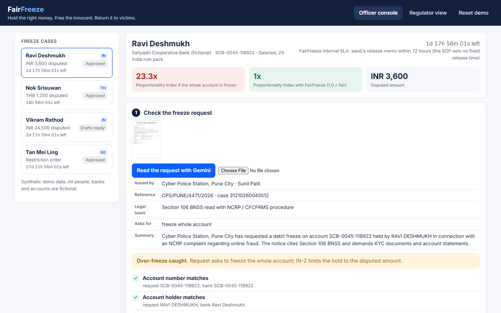
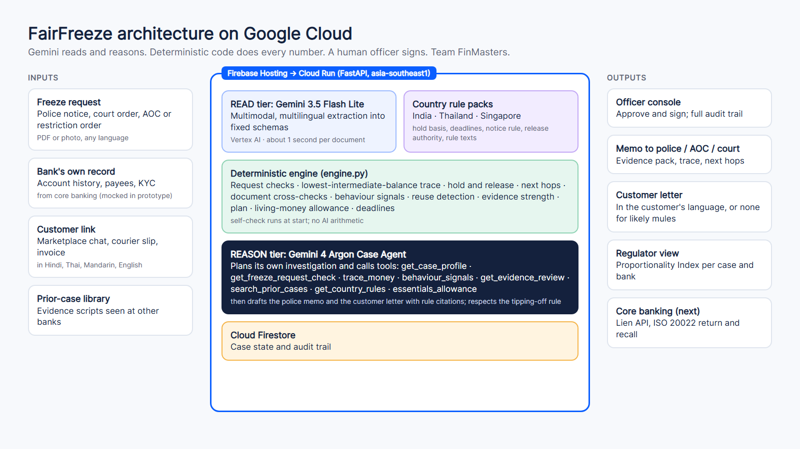

<p align="center"></p>

<p align="center"><b>Hold the right money. Free the innocent.</b><br>
Team FinMasters · Google Cloud AI Builder Cup 2026 · BFSI: Intelligent Risk, Fraud & Financial Experiences</p>

<p align="center"><a href="https://fairfreeze.web.app">Live prototype</a> · <a href="https://fairfreeze.vercel.app">Project site and demo video</a></p>



## Why we built this

We work in banking, and we kept seeing the same story. Someone sells a phone online, the buyer pays with money from a scam, and the next morning the seller's whole account is frozen. Rent, salary, medicine: all locked, sometimes for months, over a few thousand rupees or baht.

Regulators across Asia Pacific are right to push banks to freeze scam money quickly. But nobody built the other half: a way to work out what should actually stay frozen, clear the innocent people fast, and do it inside each country's rules.

- **India:** courts now tell banks to keep accounts running and hold only the disputed amount.
- **Thailand:** about 200,000 accounts were frozen in 13 months; innocent customers must be released within hours of verification.
- **Singapore:** police can restrict a likely scam *victim's* account, but daily living money must stay available.
- **Philippines and Australia:** new laws put holds, deadlines and receiving banks under scrutiny.

## What it does

FairFreeze is the desk a bank officer uses after a freeze.

1. **Check the request.** Gemini reads the police or court notice, in English, Hindi or Thai. FairFreeze checks it against the bank's own records and flags requests that go wider than the law allows.
2. **Follow the money.** It works out how much of the scam money is really still in the account, holds that, and releases the rest. A money map shows where the money came from and went, city by city, and where the account is used from.
3. **Hear the customer.** The customer gets a link in their own language, sees what is held and what is free, and uploads their side of the story.
4. **Check the evidence.** Documents are compared with the bank's records, and with past cases at other banks, so a mule can't reuse the same fake chat.
5. **Investigate and draft.** A Case Agent on Gemini 4 Argon decides which checks to run, writes up the case, and drafts the memo for the police and the letter for the customer. No letter goes to a likely mule; tipping one off is against the law.
6. **The officer decides.** Nothing is frozen or released by the AI. Every step is logged.

Regulators get one number to compare banks: the **Proportionality Index**, money held divided by money really in dispute. In our first demo case it drops from 23.3x to 1.0x.

## Demo cases

All data is synthetic. Every person, bank and account is made up.

| Case | What happens |
|---|---|
| **Ravi** (India) | Sold a phone for INR 3,600; police asked for his whole INR 84,000 account. FairFreeze holds 3,600, releases 80,400 and writes to him in Hindi. |
| **Nok** (Thailand) | Online shop owner, one THB 1,250 payment disputed. Thai notice, Thai rules, Thai letter. |
| **Vikram** (India) | Perfect-looking documents, but the same chat appears in 14 cases at 3 banks, his money left for Dubai and Hong Kong within minutes, and 92% of his logins come from Cambodia. The hold stays; no letter. |
| **Mrs Tan** (Singapore) | 72 and under a restriction order while a fake mentor asks for SGD 60,000. Her daily money stays open and the scam is explained in Mandarin. |

## How it's built



| Piece | Role |
|---|---|
| Gemini 3.5 Flash Lite on Vertex AI | Reads notices, chats and receipts into fixed structures. Fast and cheap. |
| Gemini 4 Argon on Vertex AI | The Case Agent: picks its own tools, investigates, drafts the papers. |
| `engine.py` | Every number and check: money tracing, evidence checks, reuse detection, plans. No model does arithmetic. |
| `rules.json` | One rule pack per country (India, Thailand, Singapore). |
| Cloud Run | The FastAPI app and background agent jobs. |
| Firestore | Case state and audit trail. |
| Firebase Hosting | fairfreeze.web.app |

## Run it locally

```bash
pip install -r requirements.txt
python engine.py
```

```bash
uvicorn main:app --port 8080
```

Set `GOOGLE_GENAI_USE_VERTEXAI=true`, `GOOGLE_CLOUD_PROJECT` and `GOOGLE_CLOUD_LOCATION=global` (or `GEMINI_API_KEY`). Set `FIRESTORE=off` to keep state in memory.

## Team FinMasters

Sashi Perera (product and cloud) · Ashan Abeysekera (business analysis) · Shehan Lakshitha (development) · Akila Samarakoon (QA)
